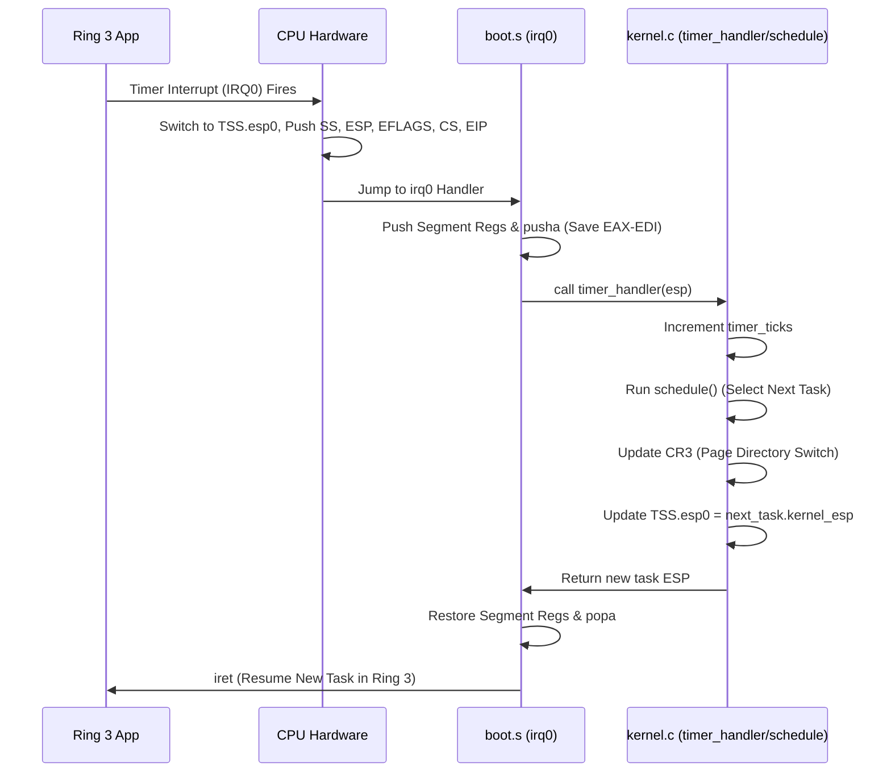

# sOS Technical Details & Architecture

This document contains a comprehensive technical breakdown of sOS, covering boot protocols, memory management, graphics architecture, the network stack, cryptographic systems, filesystem extensions, multitasking, and system call ABIs.

---

## 1. Boot Process & Initialization Sequence

sOS follows the **Multiboot 1** standard specification:

1. **Bootloader Handoff:** GRUB loads the kernel ELF into physical memory starting at `1 MB` (`0x100000`).
2. **Video Mode Request:** The Multiboot header in `boot.s` sets `FLAGS` bit 2 to request VBE Linear Graphics Mode (1024x768 resolution, 32-bit ARGB color depth).
3. **Kernel Entry (`boot.s`):**
   * Initializes the kernel stack (`16 KiB`, allocated in `.bss` from `stack_bottom` to `stack_top`).
   * Pushes Multiboot magic (`EAX = 0x2BADB002`) and the Multiboot structure pointer (`EBX`) onto the stack.
   * Calls `kernel_main()` in `kernel.c`.
4. **Subsystem Initialization Sequence:**
   1. `init_gdt()`: Loads the Global Descriptor Table and Task State Segment (TSS).
   2. `init_idt()`: Sets up the Interrupt Descriptor Table (Exceptions 0-31, IRQs, Syscall `0x80`).
   3. `init_pic()`: Remaps Master/Slave Programmable Interrupt Controllers (IRQs 0-15 mapped to IDT vectors 32-47).
   4. `init_pmm()`: Parses Multiboot memory maps and initializes the Physical Memory Manager bitmap.
   5. `init_paging()`: Sets up CR3 and enables hardware paging in CR0.
   6. `init_graphics()`: Maps the VBE Linear Framebuffer and allocates the off-screen RAM backbuffer.
   7. `init_heap()`: Sets up the kernel block allocator (`kmalloc`/`kfree`).
   8. `init_fs()`: Reads the ATA BPB sector and mounts the FAT16 partition.
   9. `init_pit()`: Configures the Programmable Interval Timer for 100 Hz preemptive ticks.
   10. `init_e1000()`: Scans the PCI bus, maps E1000 MMIO, configures RX/TX DMA rings, and enables IRQ handling.
   11. `init_multitasking()`: Prepares process structures and creates PID 0 (Shell).
   12. `net_dhcp_discover()`: Broadcasts DHCP Discover and blocks until IP assignment completes or times out.

---

## 2. Graphics Engine & Display Architecture

sOS features a hardware-accelerated 32-bit VBE graphics engine replacing classic VGA text mode:

```
+-------------------------------------------------------------------+
|                        Backbuffer (RAM)                           |
|                      Virtual: 0xE1000000                          |
|  - All text glyphs, ANSI colors, sprites, & borders drawn here    |
+-------------------------------------------------------------------+
                                  |
                        swap_buffers() / DMA
                                  v
+-------------------------------------------------------------------+
|                   Linear Framebuffer (VRAM)                       |
|                      Virtual: 0xE0000000                          |
|  - Direct Video Memory output mapped to physical VBE graphics     |
+-------------------------------------------------------------------+
```

* **VBE Framebuffer Mapping:** Physical VRAM (retrieved via Multiboot info) is mapped to virtual address `0xE0000000`.
* **RAM Backbuffer:** An off-screen backbuffer is allocated directly via PMM pages at virtual address `0xE1000000` (size = $1024 \times 768 \times 4 \approx 3\text{ MB}$).
* **Text & Font Engine:**
  * Uses an 8x16 bitmap font (`font8x16.h`).
  * Terminal dimensions in graphics mode: 128 columns $\times$ 48 rows.
  * ANSI escape sequence parser supporting full 16-color foreground customization (e.g. `\033[31m` Red, `\033[32m` Green, `\033[34m` Blue).
* **Software Cursor:** Renders a 2-pixel underline cursor directly to VRAM without dirtying the backbuffer text memory.
* **Sprite Blending Engine:** `draw_sprite()` processes 32-bit ARGB sprites using a custom alpha-blending formula:
  $$\text{Color}_{\text{final}} = \frac{\text{Color}_{\text{src}} \times \alpha + \text{Color}_{\text{bg}} \times (255 - \alpha)}{255}$$
* **Graphical Panic Screen (BSOD):** When an unhandled Ring 0 kernel exception occurs, sOS clears the VBE screen to blue (`0x000000AA`), erases the cursor, and draws a formatted system diagnostics box displaying exception type, EIP, and error code.

---

## 3. Memory Architecture & Isolation

Memory is structured into three distinct abstraction layers:

```
0x00000000 +-----------------------------------+
           | Identity Mapped Kernel (First 16MB)| Ring 0
0x07FF0000 +-----------------------------------+
           | User App Stack (4 KiB)            | Ring 3
0x08000000 +-----------------------------------+
           | User App Code / Data / BSS        | Ring 3
0x08000000 +-----------------------------------+
           | User App Dynamic Heap (sbrk)      | Ring 3
0x10000000 +-----------------------------------+
           | Kernel Heap (kmalloc) (4 MB)      | Ring 0
0xE0000000 +-----------------------------------+
           | VBE Linear Framebuffer (VRAM)     | Ring 0
0xE1000000 +-----------------------------------+
           | VBE Backbuffer (RAM)              | Ring 0
           +-----------------------------------+
```

### A. Physical Memory Manager (PMM)
* Uses a 32,768-entry `uint32_t` bitmap (`pmm_bitmap`), where each bit represents a 4 KiB physical page (capable of managing up to 4 GB of RAM).
* The first 2 MB (`512 pages`) are marked permanently reserved to prevent overwriting low kernel code, real-mode BIOS tables, and VGA memory.

### B. Virtual Memory Manager (Paging)
* **Kernel Page Directory:** Identity maps the lower 16 MB of physical RAM using 4 Page Tables (`first_page_table[4][1024]`) with Supervisor flags (`0x03` - Present/Writable).
* **User Page Directories:** When launching a Ring 3 process, a dedicated Page Directory is created cloning kernel space (upper pages) while isolating user-space pages (`0x07` - Present/Writable/User).
* **Security Bounds Verification:** System calls execute rigorous range validation routines (`is_valid_user_range()` and `is_valid_user_string()`) to verify that pointers passed by user binaries reside strictly within `[0x07FF0000 - 0x07FF1000]` (Stack) or `[0x08000000 - prog_break]` (Code/Heap).

### C. Kernel Heap Allocator (`kmalloc` / `kfree`)
* Linked-list block allocator mapped at safe kernel virtual memory `0x10000000` (256 MB mark).
* **Corruption Prevention:** Each heap block header (`heap_block_t`) stores a magic integrity signature (`HEAP_MAGIC = 0xDEADBEEF`). If an operation detects an invalid magic value, the kernel immediately halts with a `[KERNEL PANIC]` to prevent memory poisoning.

---

## 4. GDT, IDT, & Exception Handling

### Global Descriptor Table (GDT)
Configures a flat memory model with 6 descriptors:

| Entry | Selector | Base | Limit | Access | Granularity | Privilege | Purpose |
| :--- | :--- | :--- | :--- | :--- | :--- | :--- | :--- |
| **0** | `0x00` | `0x0` | `0x0` | `0x00` | `0x00` | - | Null Descriptor |
| **1** | `0x08` | `0x0` | `4 GB` | `0x9A` | `0xCF` | Ring 0 | Kernel Code Segment |
| **2** | `0x10` | `0x0` | `4 GB` | `0x92` | `0xCF` | Ring 0 | Kernel Data Segment |
| **3** | `0x18` | `0x0` | `4 GB` | `0xFA` | `0xCF` | Ring 3 | User Code Segment |
| **4** | `0x20` | `0x0` | `4 GB` | `0xF2` | `0xCF` | Ring 3 | User Data Segment |
| **5** | `0x28` | `&tss`| `sizeof(TSS)` | `0x89` | `0x40` | Ring 0 | Task State Segment (TSS) |

The **Task State Segment (TSS)** is loaded via `ltr 0x28`. Its `esp0` field is updated dynamically during process context switches to supply the kernel stack address when an interrupt transitions the CPU from Ring 3 to Ring 0.

### Interrupt Descriptor Table (IDT)
Contains 256 interrupt gates:
* Vectors `0 - 31`: CPU Exceptions (Fault handler).
* Vector `32` (`IRQ0`): System Timer (100 Hz).
* Vector `33` (`IRQ1`): PS/2 Keyboard.
* Vector `36` (`IRQ4`): Serial Port COM1 (Deprecated).
* Vector `32 + irq_nic`: Intel E1000 Network Card Interrupt.
* Vector `128` (`0x80`): Software Syscall gate configured with DPL 3 (`0xEE`), permitting execution from Ring 3 applications.

---

## 5. Preemptive Multitasking Architecture

Multitasking is managed preemptively by `IRQ0` (PIT timer firing every 10 ms):



Process structures (`task_t`) track page directory pointers, system stacks, user stacks, virtual memory heap boundaries (`prog_break`), user IDs (`uid`), background flags (`is_background`), and file descriptor tables (`file_descriptor_t open_files[16]`).

---

## 6. Network Stack Architecture

sOS contains a complete L2-L7 Network Stack:

```
+-----------------------------------------------------------------+
| Application Layer: DHCP Client, DNS Resolver, HTTP (wget/update)|
+-----------------------------------------------------------------+
| Transport Layer: UDP / Minimal TCP State Machine                |
+-----------------------------------------------------------------+
| Network Layer: IPv4, ARP Cache, ICMP Echo Responder             |
+-----------------------------------------------------------------+
| Link Layer: Ethernet II, Intel E1000 Driver (MMIO / DMA Rings)  |
+-----------------------------------------------------------------+
```

### Driver & Link Layer (Intel E1000)
* **PCI Detection:** Scans PCI configuration space for Vendor `0x8086` and Device `0x100E`.
* **MMIO & Bus Mastering:** Maps BAR0 memory-mapped I/O registers into kernel paging space and enables PCI Bus Mastering (bit 2 in PCI Command register).
* **DMA Ring Buffers:**
  * **RX Ring:** 32 descriptors (`e1000_rx_desc`), each allocated a dedicated 4 KiB physical page for hardware packet DMA transfers.
  * **TX Ring:** 8 transmit descriptors (`e1000_tx_desc`).

### Network Protocols
* **ARP Cache:** Maintains a 32-entry lookup table mapping IPv4 addresses to MAC addresses. Automatically sends ARP requests and blocks synchronously on cache misses.
* **ICMP Responder:** Intercepts ICMP Echo Requests (Type 8) and transmits Echo Replies (Type 0) in hardware.
* **UDP Engine:** Supports kernel socket binding and user-space packet routing across 16 global socket slots.
* **TCP Engine:** Implements a minimal TCP State Machine (`CLOSED`, `SYN_SENT`, `ESTABLISHED`) supporting sequence/acknowledgment numbers, retransmission detection, $32\text{ KB}$ dynamic receive window buffers (`SOCK_BUF_SIZE`), and `PSH`/`FIN` flag handling.
* **DHCP Client:** Automatically broadcasts `DHCP Discover` on boot, parses `DHCP Offer`, requests the IP, and configures local IP, Gateway, Subnet Mask, and DNS server addresses.
* **DNS Resolver:** `net_gethostbyname()` parses raw IPv4 strings instantly or constructs UDP DNS query packets (port 53) to resolve domain names to IP addresses.

---

## 7. Cryptography & Security Architecture

### Hashing & Cryptographic Algorithms
* **SHA-256 & HMAC-SHA256:** Native implementation (`crypto.c`) capable of computing 32-byte message authentication codes over arbitrary data blocks using secret keys.
* **Salted Password Hashing:**
  * Password hashes stored in `/passwd` use Pseudo-Random Number Generation (`generate_salt()`) to create an 8-character hex salt.
  * Hashing applies salted key-stretching (10,000 iterations of FNV-1a hashing over `salt + password`).
  * Stored representation format: `salt$hash` (e.g. `a1b2c3d4$e5f6a7b8`).

### FAT16 File Security Byte Hack (`sec_byte`)
Standard FAT16 uses byte offset `0x0C` in directory entries as reserved. sOS repurposed byte `0x0C` into the **Security Byte** (`sec_byte`):

```
 Bit 7     Bit 6     Bit 5     Bit 4     Bit 3   Bit 2   Bit 1   Bit 0
+---------+---------+---------+---------+-------+-------+-------+-------+
| Other W | Other R | Owner W | Owner R |     Owner UID (0 to 15)       |
+---------+---------+---------+---------+-------+-------+-------+-------+
```

Permissions are evaluated dynamically on every file/directory open operation:
* Owner check: `active_uid == owner_uid` $\rightarrow$ verify Owner R/W bits.
* Other check: `active_uid != owner_uid` $\rightarrow$ verify Other R/W bits.
* `UID 0` (`root`) overrides all security checks.

---

## 8. Filesystem (FAT16) & ATA Driver

* **ATA PIO Driver:** Reads and writes 512-byte sectors using Primary ATA ports (`0x1F0` - `0x1F7`) with polling on status bits (`BSY` and `DRQ`).
* **Path Resolver (`resolve_path()`):** Handles absolute (`/path`) and relative (`path`, `.`, `..`) directory traversal across cluster chains.
* **File Operations:** Implements full file creation, cluster allocation/linking, directory creation (`mkdir`), deletion (`rm`), file copy (`cp`), moving (`mv`), and binary append capabilities.
* **Wildcard Processing:** Management utilities (`rm`, `chown`, `chmod`) natively parse wildcard characters (`*`) to process all entries in the active directory.

---

## 9. Cryptographic OTA Firmware Updates

The `update` command executes an Over-The-Air (OTA) kernel update:

```
[Server HTTP]                       [sOS Kernel]
  /kernel.sig  -------------------> Download 64-byte signature
  /kernel.bin  -------------------> Download binary image
                                            |
                                  Compute HMAC-SHA256(bin, secret_key)
                                            |
                                  Compare Computed Sig vs Expected Sig
                                            |
                                  +---------+---------+
                                  |                   |
                              [Match]             [Mismatch]
                                  |                   |
                        Flash raw disk via ATA     Abort Update & Error
                        Create /updt.flg flag
                        Reboot System (0x64)
                                  |
                        [On Boot] Read /updt.flg
                        Show Green Update Success
                        Delete /updt.flg
```

---

## 10. System Call ABI Specification

User applications invoke system call routines via `int 0x80`. Registers pass parameters according to the following ABI:
* `EAX`: System Call Number
* `EBX`: Argument 1
* `ECX`: Argument 2
* `EDX`: Argument 3

| EAX | System Call | EBX (`arg1`) | ECX (`arg2`) | EDX (`arg3`) | Return Value (EAX) |
| :--- | :--- | :--- | :--- | :--- | :--- |
| **1** | `sys_write` | File Descriptor (`fd`) | Buffer Pointer (`buf`) | Byte Count (`count`) | Bytes written or `-1` |
| **2** | `sys_exit` | Exit Code | - | - | Does not return |
| **3** | `sys_sbrk` | Heap Increment (bytes) | - | - | Previous heap break address |
| **4** | `sys_read` | File Descriptor (`fd`) | Buffer Pointer (`buf`) | Max Bytes (`count`) | Bytes read or `-1` |
| **5** | `sys_uptime` | - | - | - | System timer ticks (100 Hz) |
| **6** | `sys_read_file`| Filename string | Output Buffer | Size Pointer (`uint32_t*`) | `1` on success, `0` on fail |
| **7** | `sys_write_file`| Filename string | Text String | - | `1` on success, `0` on fail |
| **8** | `sys_socket` | - | - | - | Socket FD or `-1` |
| **9** | `sys_bind` | Socket FD | Port (`uint16_t`) | - | `0` on success, `-1` on fail |
| **10**| `sys_sendto` | Socket FD | `sendto_args_t*` struct | - | Bytes sent or `-1` |
| **11**| `sys_recvfrom` | Socket FD | Buffer Pointer | Max Length | Bytes received or `0` |
| **12**| `sys_get_dns_ip`| Buffer (`uint8_t[4]`) | - | - | `1` on success, `0` on fail |
| **13**| `sys_socket_tcp`| - | - | - | TCP Socket FD or `-1` |
| **14**| `sys_connect` | Socket FD | Dest IP (`uint8_t[4]`) | Port (`uint16_t`) | `0` on success, `-1` on fail |
| **15**| `sys_send` | Socket FD | Buffer Pointer | Length | Bytes sent or `-1` |
| **16**| `sys_recv` | Socket FD | Buffer Pointer | Max Length | Bytes received or `0` |